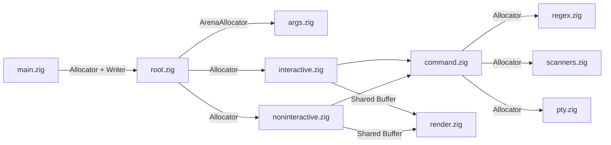

# Requirements

### Overview & Goals

Refactor `run-pty-zig` to follow idiomatic Zig 0.17 practices based on the code review findings, eliminating pervasive `std.heap.page_allocator` usage, fixing memory leaks and ambiguous ownership contracts, replacing `@panic("oom")` with proper error propagation, removing duplicated standard-library helpers, and fixing subtle bugs (such as exclusive character ranges in `src/regex.zig`).

### Scope

#### In Scope
- **Allocator Threading**: Replace hardcoded `std.heap.page_allocator` calls in `src/root.zig`, `src/command.zig`, `src/regex.zig`, `src/pty.zig`, and `src/args.zig` tests with explicitly passed `std.mem.Allocator` instances (only keeping `page_allocator` inside the post-`fork` child branch of `Pty.spawn` right before `execvp`).
- **Ownership & Lifecycle Cleanup**: Make slice ownership unambiguous in `indicators.extractStatus`, `scanners.respondToRequestFake`, `Command.joinHistory`, and `Pty.drain`; add `deinit` methods to `Command` and `ParseResult` so all history buffers, regexes, and command descriptions are properly freed.
- **Idiomatic Error Handling**: Replace `catch @panic("oom")` / `@panic("spawn failed")` / `@panic("write failed")` in `src/scanners.zig` and `src/noninteractive.zig` with `try` error propagation, and remove unreachable `error.Exit` checks in `src/interactive.zig`.
- **Rendering Allocation Reduction**: Refactor `src/render.zig` to write into shared buffers (`*std.array_list.Managed(u8)` / writer) or use a frame-scoped arena so rendering a dashboard frame does not perform dozens of tiny transient heap allocations.
- **Stdlib Consolidation & Type Unification**: Replace re-implemented string/character functions in `src/scanners.zig`, `src/ansi.zig`, `src/render.zig`, and `src/command.zig` with `std.mem` / `std.ascii` equivalents, and unify `types.StatusTuple` with `indicators.StatusValue`.
- **Bug Fixes & Build/Module Polish**:
  - Fix exclusive range loops `'0'..'9'`, `'a'..'z'`, `'A'..'Z'` in `src/regex.zig` to include `'9'`, `'z'`, and `'Z'`.
  - Fix `signal` extern declaration in `src/interactive.zig` to use `?*const fn (c_int) callconv(.c) void`.
  - Clean up `src/terminal.zig` stubbed functions and wire terminal detection into `root.detectEnv()`.
  - Consolidate unit test execution in `build.zig`.

#### Out of Scope
- Changing CLI arguments, JSON config schema, keybindings, or user-visible terminal output behavior.
- Adding external dependencies outside the Zig standard library.

### Functional Requirements
1. All CLI modes (interactive TTY dashboard, focused command view, `--auto-exit` interactive and non-interactive CI mode, `--help`, `--version`, JSON config parsing) must preserve exact functional parity.
2. Regex character classes `\d`, `\D`, `\w`, and `\W` must accurately match boundary characters `'9'`, `'z'`, and `'Z'`.
3. Unit tests across all modules must pass under `std.testing.allocator` with zero memory leaks.

# Technical Design

### Current Implementation
The codebase is organized into focused modules under `src/` (`main.zig`, `root.zig`, `types.zig`, `args.zig`, `labels.zig`, `ansi.zig`, `indicators.zig`, `command.zig`, `render.zig`, `pty.zig`, `scanners.zig`, `regex.zig`, `noninteractive.zig`, `interactive.zig`, and `terminal.zig`). Currently:
- `src/root.zig:71`, `src/command.zig`, `src/regex.zig`, and `src/pty.zig:123` hardcode `std.heap.page_allocator` for small, frequent allocations.
- Functions like `indicators.extractStatus`, `Command.joinHistory`, and `scanners.respondToRequestFake` return either borrowed slices or heap-allocated slices depending on runtime branches, leading to leaks in `interactive.zig` and `noninteractive.zig`.
- `scanners.splitAlternateScreen` and `noninteractive.run` use `catch @panic(...)` inside functions that already return error unions.

### Key Decisions
1. **Explicit Allocator Threading + Scoped Arenas**:
   - `main.zig` passes an explicit `Allocator` (`std.heap.c_allocator` or `smp_allocator`, plus `init.arena.allocator()` for startup CLI/config structures) into `run_pty_zig.run`.
   - Every allocating function (`Regex.compile`, `Pty.drain`, `Command` methods) accepts an explicit `Allocator`.
   - Unit tests in `src/args.zig` wrap `std.testing.allocator` in `std.heap.ArenaAllocator` so `parseFromSliceLeaky` allocations are verified and freed at test teardown.
2. **Consistent Owned Return Contracts**:
   - `Command.joinHistory(self: *const Command, allocator: Allocator) ![]u8`, `Pty.drain(self: *const Pty, allocator: Allocator) ![]u8`, `scanners.respondToRequestFake(allocator: Allocator, request: []const u8) ![]u8`, and `indicators.extractStatus(allocator: Allocator, status: ?StatusValue, env: Env) !?[]u8` always returnslices owned by `allocator` (or write into a caller-provided buffer), so callers can unconditionally `defer allocator.free(...)`.
3. **Unified `StatusTuple` Representation**:
   - `types.StatusTuple` (`struct { primary: []const u8, degraded: []const u8 }`) is used directly by `indicators.zig`, `command.zig`, `render.zig`, and `noninteractive.zig` (aliasing `pub const StatusValue = types.StatusTuple;`), eliminating the duplicate `toStatusValue` converters in `command.zig` and `noninteractive.zig`.
4. **Writer/Buffer-Based Internal Rendering in `src/render.zig`**:
   - Internal styling and layout helpers write into a shared `*std.array_list.Managed(u8)` buffer (e.g., `appendDim`, `appendBold`, `appendShortcut`) to avoid allocating and freeing dozens of tiny slices per dashboard line.

### Proposed Changes

#### 1. Bug Fixes, Stdlib Replacements & Type Unification (`src/regex.zig`, `src/scanners.zig`, `src/ansi.zig`, `src/types.zig`, `src/indicators.zig`)
- **`src/regex.zig`**:
  - Fix lines 326–347: change `for ('0'..'9')`, `for ('a'..'z')`, `for ('A'..'Z')` to `for ('0'..'9' + 1)`, `for ('a'..'z' + 1)`, `for ('A'..'Z' + 1)`.
  - Pass `allocator: Allocator` to `Regex.compile(allocator, pattern)` and store `allocator` in `Regex` (or pass to `deinit`) so `Regex.deinit` and `Node.free` free with the same allocator.
- **`src/scanners.zig`**:
  - Remove `containsIndex`, `endsWith`, `contains`, and `startsWith` (lines 129–155) and use `std.mem.indexOf(u8, ...)`, `std.mem.startsWith(u8, ...)`, and `std.mem.endsWith(u8, ...)`.
  - Replace `catch @panic("oom")` in `splitAlternateScreen` (lines 75–87) with `try`.
  - Update `respondToRequestFake` to `allocator.dupe(u8, ...)` static responses so the returned slice is always owned by `allocator`.
- **`src/ansi.zig` & `src/render.zig`**:
  - Replace `isDigit` in `src/ansi.zig:31` with `std.ascii.isDigit`.
  - Add `pub fn visibleLen(s: []const u8) usize` in `src/ansi.zig` using `findSgrEnd`, and use it in `src/ansi.zig:truncate` and `src/render.zig` (removing `removeGraphicRenditionsLen` in `src/render.zig:795`).

#### 2. `Command` & `Pty` Ownership (`src/command.zig`, `src/pty.zig`)
- **`src/pty.zig`**:
  - Change `pub fn drain(self: *const Pty, allocator: std.mem.Allocator) ![]u8` to allocate with `allocator`.
- **`src/command.zig`**:
  - Add `allocator: std.mem.Allocator` field to `Command` (defaulting to `std.testing.allocator` in `Command.forTest`) and add `pub fn deinit(self: *Command) void` to free `self.history` and `self.history_alternate_screen` if `.len > 0` and close `self.pty` if active.
  - Free existing `self.history` and `self.history_alternate_screen` before resetting them to `""` in `Command.start` (lines 146–147) and in `Command.pushHistory` on `scanners.matchesClear` (lines 215–216).
  - Update `appendCapped(allocator: Allocator, existing: []const u8, chunk: []const u8, max: usize) ![]const u8` to use `allocator`.
  - Update `updateStatusFromRules` and `pushHistory` to use `self.allocator` instead of `std.heap.page_allocator`.
  - Update `joinHistory(self: *const Command, allocator: Allocator) ![]u8` to always return an owned slice allocated with `allocator`.
  - Simplify `getLastLine(s: []const u8) []const u8` using `std.mem.lastIndexOfAny(u8, s, "\r\n")`.

#### 3. Runners & Entry Point (`src/main.zig`, `src/root.zig`, `src/noninteractive.zig`, `src/interactive.zig`, `src/terminal.zig`, `build.zig`)
- **`src/main.zig` & `src/root.zig`**:
  - Add `runWithAllocator(allocator: Allocator, writer: *Io.Writer, args: []const [:0]const u8, stdin_is_tty: bool) !void` (or update `run` signature) and use an `ArenaAllocator` for `parseArgs` so all `CommandDescription` fields are cleanly freed on exit.
  - Wire `terminal.Capabilities` into `detectEnv()` and remove stubbed unused `twentyFiveSixFg`/`Bg` and `truecolorFg`/`Bg` functions from `src/terminal.zig`.
- **`src/noninteractive.zig`**:
  - Replace all `catch @panic(...)` calls with `try`.
  - `defer cmd.deinit()` for all commands on exit.
  - Properly `defer allocator.free(remaining)` after `pty.drain(allocator)` and `defer allocator.free(response)` after `scanners.respondToRequestFake(allocator, data)`.
- **`src/interactive.zig`**:
  - Fix `extern "c" fn signal(sig: c_int, handler: ?*const fn (c_int) callconv(.c) void) c_int;` and remove `@constCast` on `&signalHandler` and `&resizeHandler`.
  - In `switchToCommand`, free the slice returned by `command.joinHistory(self.allocator)`.
  - In `handleExit`, pass `self.allocator` to `command.pty.?.drain(self.allocator)` and free the result.
  - In `Session.deinit`, call `cmd.deinit()` on each command and free `formatted_command_with_title`.
  - Remove unreachable `if (err == error.Exit)` branch in `interactive.run`.
- **`build.zig`**:
  - Add a `test { std.testing.refAllDecls(@This()); }` block in `src/root.zig` referencing all internal modules so `zig build test` can run all unit tests in a unified test binary instead of compiling 13 separate test executables.

### Data Models / Contracts

```zig
// src/types.zig & src/indicators.zig
pub const StatusTuple = struct {
    primary: []const u8,
    degraded: []const u8,
};
pub const StatusValue = types.StatusTuple;

// src/regex.zig
pub const Regex = struct {
    allocator: Allocator,
    nodes: []Node,
    pub fn compile(allocator: Allocator, pattern: []const u8) Error!Regex;
    pub fn deinit(self: *Regex) void;
};

// src/pty.zig
pub fn drain(self: *const Pty, allocator: Allocator) ![]u8;

// src/command.zig
pub const Command = struct {
    allocator: Allocator = std.heap.page_allocator,
    // ... existing fields ...
    pub fn deinit(self: *Command) void;
    pub fn joinHistory(self: *const Command, allocator: Allocator) ![]u8;
};
```

### Architecture Diagram



### Risks
- **Freeing static string literals on history reset/deinit**: `Command.history` and `Command.history_alternate_screen` initialize to `""`. `Command.deinit` and history resets must only call `self.allocator.free(...)` when `slice.len > 0` (matching the invariant that non-empty history slices are heap-allocated by `appendCapped`).
- **Signal handler signature on macOS**: Using `?*const fn (c_int) callconv(.c) void` matches Zig's C ABI function pointer representation on macOS and eliminates `@constCast`.

# Testing

### Validation Approach
All refactoring stages will be verified using `zig build test` and `zig build` to ensure every unit test compiles and passes with `std.testing.allocator` leak detection active.

### Key Scenarios
1. **Regex Boundary Matching (`src/regex.zig`)**:
   - Verify `\d` matches `'0'` through `'9'` (specifically `'9'`), and `\D` rejects `'9'`.
   - Verify `\w` matches `'a'`–`'z'`, `'A'`–`'Z'`, `'0'`–`'9'`, `'_'` (specifically `'z'`, `'Z'`, `'9'`), and `\W` rejects them.
2. **Leak-Free Command & History Lifecycle (`src/command.zig`)**:
   - Run `pushHistory`, alternate-screen transitions, clear-screen resets (`\x1B[2J`), `updateStatusFromRules`, and `joinHistory` using `std.testing.allocator` and confirm `cmd.deinit()` leaves zero leaked bytes.
3. **Config & CLI Parsing with Arena (`src/args.zig`)**:
   - Run all JSON config and CLI flag tests using `std.heap.ArenaAllocator.init(std.testing.allocator)` to verify memory cleanup.
4. **End-to-End Non-Interactive Execution**:
   - Run `zig build` and execute `./zig-out/bin/run-pty --auto-exit % echo hello % echo world` in non-TTY mode to verify output formatting and exit code `0`.

### Edge Cases
- **Empty history `deinit` and clear**: Calling `cmd.deinit()` on a command that never produced output or was cleared with `\x1B[2J` must not attempt to free `""`.
- **`NO_COLOR` vs color `extractStatus`**: Callers freeing the result of `extractStatus` must work identically whether `NO_COLOR` is set or unset.
- **Terminal query fake responses**: Both static (`\x1B[6n`) and dynamic (`\x1B]10;?`) queries in `respondToRequestFake` must be safely freed by the caller without leaks or invalid frees.

# Delivery Steps

### ✓ Step 1: Stage 1: Fix regex range bugs and consolidate stdlib, ANSI, and status types
Regex character classes include upper bounds (`'9'`, `'z'`, `'Z'`) and all duplicated stdlib/ANSI/status helpers are consolidated into canonical definitions.

- Fix exclusive `for` loop ranges in `src/regex.zig` (`\d`, `\D`, `\w`, `\W`) by changing `'0'..'9'`, `'a'..'z'`, and `'A'..'Z'` to `'0'..'9' + 1`, `'a'..'z' + 1`, and `'A'..'Z' + 1`, and add unit tests verifying `'9'`, `'z'`, and `'Z'`.
- Replace custom `containsIndex`, `startsWith`, `endsWith`, and `contains` in `src/scanners.zig` with `std.mem.indexOf`, `std.mem.startsWith`, and `std.mem.endsWith`.
- Replace `getLastLine` in `src/command.zig` with `std.mem.lastIndexOfAny(u8, s, "\r\n")`.
- Replace `isDigit` in `src/ansi.zig` with `std.ascii.isDigit`, expose `visibleLen` (using `findSgrEnd`) in `src/ansi.zig`, and remove the duplicate `removeGraphicRenditionsLen` in `src/render.zig`.
- Unify `types.StatusTuple` and `indicators.StatusValue` so `toStatusValue` is no longer duplicated across `src/command.zig` and `src/noninteractive.zig`.
- Fix `extern "c" fn signal` in `src/interactive.zig` to use `?*const fn (c_int) callconv(.c) void` and remove `@constCast` on signal handler pointers.

### ✓ Step 2: Stage 2: Thread allocators and fix ownership in leaf modules (regex, pty, scanners, indicators, args)
`Regex`, `Pty.drain`, `indicators.extractStatus`, and `scanners` accept explicit allocators, propagate errors with `try`, and have unambiguous ownership semantics.

- Update `Regex.compile(allocator: Allocator, pattern: []const u8)` and `Regex.deinit(self: *Regex, allocator: Allocator)` (plus `Node.free`) in `src/regex.zig` to use the passed `Allocator` instead of `std.heap.page_allocator`, and update all tests in `src/regex.zig` to use `std.testing.allocator`.
- Update `Pty.drain(self: *const Pty, allocator: Allocator) ![]u8` in `src/pty.zig` to take an `Allocator` instead of `std.heap.page_allocator`.
- Replace `catch @panic("oom")` with `try` in `scanners.splitAlternateScreen` (`src/scanners.zig`).
- Make `scanners.respondToRequestFake(allocator: Allocator, request: []const u8) ![]u8` and `indicators.extractStatus(allocator: Allocator, status: ?StatusValue, env: Env) !?[]u8` consistently return caller-owned slices (or use an explicit writer/buffer) so callers can unconditionally `free` non-null results without inspecting `env.no_color`.
- Update unit tests in `src/args.zig` to wrap `std.testing.allocator` in `std.heap.ArenaAllocator` instead of using `std.heap.page_allocator`, enabling leak detection across all parser tests.

### ✓ Step 3: Stage 3: Refactor Command lifecycle, history management, and regex matching
`Command` manages its history and status-rule memory via an explicit `Allocator` and `deinit`, with zero `std.heap.page_allocator` calls in `src/command.zig`.

- Add an `allocator: Allocator` field (or parameter) and `pub fn deinit(self: *Command) void` to `Command` in `src/command.zig` to free `history` and `history_alternate_screen` when non-empty, as well as freeing old buffers when `start()` or `matchesClear` resets history.
- Update `appendCapped`, `pushHistory`, `updateStatusFromRules`, and `joinHistory(self: *const Command, allocator: Allocator) ![]u8` in `src/command.zig` to use the passed `Allocator` and return owned slices with clear error propagation.
- Pre-compile or pass `self.allocator` into `Regex.compile` / `Regex.deinit` inside `updateStatusFromRules`.
- Update all unit tests in `src/command.zig` to use `std.testing.allocator` and `defer cmd.deinit()` to verify zero leaks.

### ✓ Step 4: Stage 4: Refactor runners (root, noninteractive, interactive) for allocator threading and error handling
`root.zig`, `noninteractive.zig`, and `interactive.zig` accept an explicit `Allocator`, propagate errors without `@panic("oom")`, and clean up all session/command allocations.

- Update `run` in `src/root.zig` and `src/main.zig` to accept an explicit `Allocator` (using `std.heap.c_allocator` or `smp_allocator` in `main.zig` alongside `init.arena.allocator()` for CLI parsing) and properly free `ParseResult` and `CommandDescription` slices.
- Remove all `catch @panic("oom")`, `catch @panic("spawn failed")`, and `catch @panic("write failed")` in `src/noninteractive.zig`, propagating errors with `try` and freeing `Pty.drain` and `respondToRequestFake` slices properly.
- Update `src/interactive.zig` (`Session` and `run`) to free `command.joinHistory(self.allocator)`, free `Pty.drain(self.allocator)`, call `cmd.deinit()` on cleanup, and remove dead `error.Exit` handling.

### ✓ Step 5: Stage 5: Optimize render.zig allocations, clean up terminal.zig, and streamline build.zig tests
`render.zig` minimizes transient per-frame heap allocations, `terminal.zig` is cleaned up and wired in, and `build.zig` runs all module tests cleanly.

- Refactor internal formatting helpers in `src/render.zig` (such as `dim`, `bold`, `invert`, `shortcut`, `cwdText`, and title builders) to write directly into shared `std.array_list.Managed(u8)` buffers (or use a per-render arena reset) while preserving public API helpers and existing rendering behavior.
- Clean up `src/terminal.zig` by removing unused stubbed color methods (`twentyFiveSixFg`/`Bg`, `truecolorFg`/`Bg`) or implementing them with stack buffers, and wire `Capabilities.detectUnicode` / `NO_COLOR` into `root.detectEnv()`.
- Consolidate the unit test runner in `build.zig` using `std.testing.refAllDecls` in `src/root.zig` so `zig build test` compiles and runs all unit tests efficiently with full leak checking.