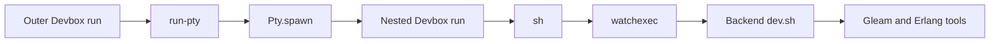

# Requirements

### Goal
Identify why GleamingSigns appears to use the wrong Gleam/Erlang toolchain through run-pty, and correct the demonstrated cause without guessing.

- Compare executable paths and versions for `gleam`, `erl`, `erlc`, and `rebar3` directly under Devbox and through run-pty.
- Preserve exported environment variables and `PATH` ordering when spawning and restarting commands.
- Provide a documented, reproducible Devbox launch recipe.
- Do not add automatic Devbox activation, change package pins, delete build artifacts, or modify GleamingSigns as part of this task. If the cause belongs there, report the exact configuration/script correction separately.

# Technical Design

### Findings
- `src/pty.zig`: `Pty.spawn` uses `fork` followed by libc `execvp`; this normally inherits the environment and searches the inherited `PATH`. It does not initialize a shell or activate Devbox when changing directories.
- `src/command.zig`: `Command.start` delegates to that same spawn path. Both interactive and noninteractive runners use it.
- GleamingSigns `devbox.json` includes `gleam@latest` and pins Erlang/rebar3 to `beam28Packages` at Nix revision `319e4cebef10cbb636c6ea392137b52ad105336a`.
- Its `overseer-pty.json` backend command explicitly runs `devbox run -- sh -c`, then `watchexec`, then `overseer/backend/scripts/dev.sh`. That script checks tool availability, builds dependencies, and verifies BEAM loading; availability checks alone do not prove version consistency.

### Approach
Use read-only toolchain probes, not a backend build or running server. Compare selected environment values (`PATH`, relevant Devbox and Erlang settings), resolved executable paths, and version output at each existing launch boundary. Do not dump the full environment or secrets.

First compare a direct Devbox command with an identical command under `run-pty --auto-exit`, using the same project directory and Devbox entry point. Then isolate the existing nested Devbox invocation, shell, watcher, and script environment as needed. Check installed run-pty versus a source build to avoid attributing binary-version differences to current source.

Only change runtime behavior if a minimal reproduction establishes a defect in `Pty.spawn` or `Command.start`. Preserve literal argv execution and existing `execvp` semantics; do not introduce shell startup or Devbox-specific PATH rewriting as a workaround. If the environment and tool paths agree, investigate/report toolchain or existing BEAM compatibility separately rather than treating it as an inheritance failure.

### Existing launch chain

No new subsystem or changes to module interactions are proposed.

# Testing

### Regression coverage
Extend the inline PTY tests in `src/pty.zig`, following its existing spawn/read/wait pattern:
- An exported sentinel reaches a child unchanged.
- Two same-named temporary executables resolve according to parent `PATH` order.
- Changing child `cwd` does not replace inherited `PATH`.
- Any temporary environment overrides are restored and isolated from parallel tests.

Exercise repeated starts through `Command.start` in `src/command.zig` to confirm each child receives the parent's environment. Run `zig build test` and a noninteractive end-to-end probe with a controlled environment.

Devbox-specific checks are optional integration validation, not a mandatory dependency of the test suite. Compare GleamingSigns paths and versions without installing/updating packages, running initialization hooks with unknown side effects, or rebuilding application artifacts; inspect hooks before executing the relevant entry point.

# Delivery Steps

### ✓ Step 1: Isolate the compiler-selection mismatch
A minimal comparison identifies the first launch boundary where tool paths or versions differ, or establishes that they agree.
- Inspect the remaining relevant GleamingSigns launch entries and shell/watcher configuration read-only.
- Probe direct Devbox execution and the equivalent run-pty invocation from the same working directory.
- Compare `gleam`, `erl`, `erlc`, and `rebar3` paths and versions, including Erlang runtime identity.
- Narrow any difference across nested Devbox, shell, and watcher boundaries without starting servers or rebuilding dependencies.

### ✓ Step 2: Protect environment and executable-resolution behavior
Automated regressions cover inherited environment and PATH selection, with a narrowly scoped runtime correction only if demonstrated necessary.
- Extend `src/pty.zig` inline tests for exported values, competing executable names, PATH order, and child working directories.
- Extend `src/command.zig` coverage for repeated command starts.
- Isolate and restore test environment changes to avoid cross-test interference.
- Correct the proven spawn/start defect if present; otherwise retain runtime behavior and document the external cause.
- Run `zig build test` and controlled noninteractive CLI probes.

### ✓ Step 3: Document the verified Devbox workflow
The README explains how to launch and diagnose Devbox-managed commands without silently selecting another toolchain.
- Add a Devbox usage section to `README.md` with the verified launch recipe and targeted path/version checks.
- Explain inherited exported variables, literal argv execution, working-directory limitations, and environment freshness on restarts.
- Record the GleamingSigns finding and any recommended external script/configuration correction without editing that project.
- Validate documentation commands against the reproduced behavior.